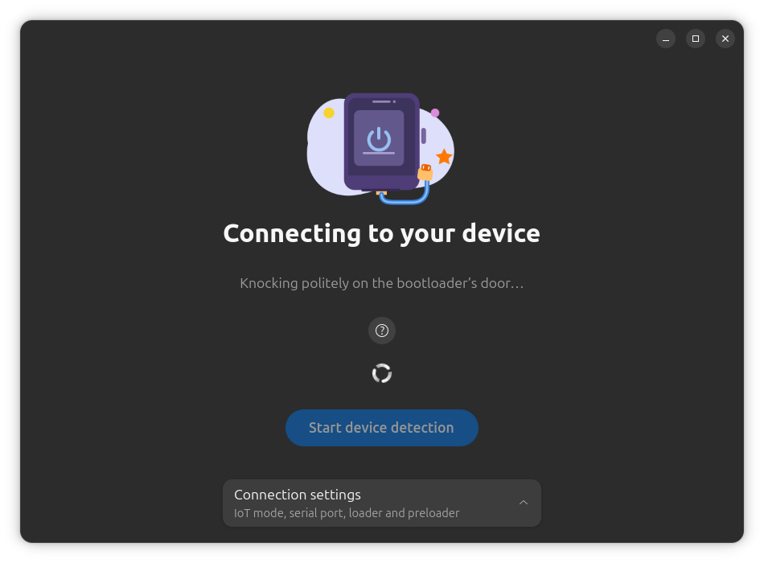
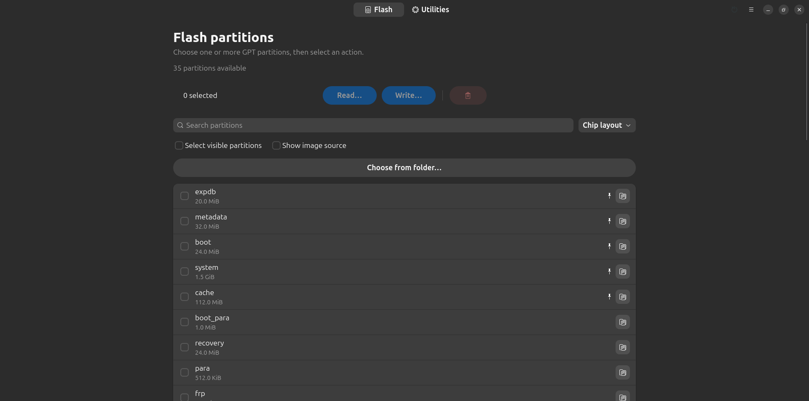
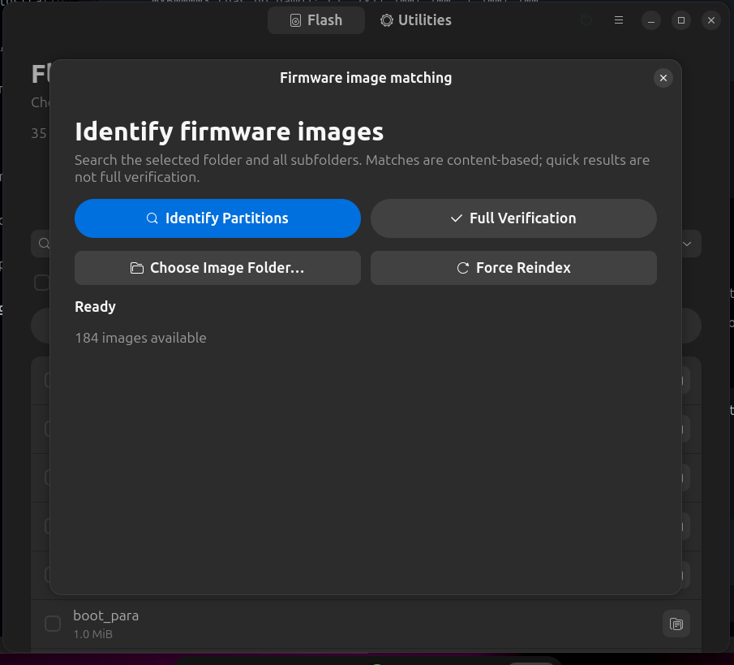

#  Fuse


An independent GNOME-native client shell built with Python, PyGObject, GTK 4, and libadwaita. The existing Qt GUI and backend under `../mtkclient/` are intentionally untouched.

## Run

Install GTK 4 and libadwaita development/runtime packages plus PyGObject for your distribution, then run:

```sh
./run.sh
```

Install MTK Client from **Preferences → Backend installation**, or choose an existing checkout under **MTK Client backend**. Installation downloads it into the user's data directory and uses `uv` when available, otherwise a private venv and pip. It does not use sudo. USB access can be configured separately from **Preferences → USB device access**. Where PolicyKit is available, the app requests authorization for a focused udev rule; otherwise it displays manual commands. The rule grants the active local user access to MediaTek and common Android USB vendor IDs. Reconnect the device after setup. The selection is saved per user and used by both `./run.sh` and the GNOME app-grid launcher. For temporary overrides during development, set `MTKCLIENT_DIR` to a directory containing the checkout's `pyproject.toml` and `uv.lock`:

```sh
MTKCLIENT_DIR=/path/to/mtk-client ./run.sh
```

## Screenshots

**Connecting to a device**



**Managing partitions**



**Finding firmware image sources**



## Features

- Read, write, and erase GPT partitions. Search, sort, and pin partitions.
- Find firmware image sources: choose a folder of candidate images. Fuse compares their fingerprints with device partitions and shows which image likely produced each partition. Full verification is also available.
- Read and write whole-device storage.
- Generate device keys and lock or unlock the bootloader.
- Use an existing MTK Client installation to save storage, or download and install the backend with one click.

Device operations run through the MTK Client backend. Destructive actions require confirmation. Hardware behavior has not yet been validated end-to-end; test on a supported device before relying on these operations.

## GNOME app-grid shortcut

Make the wrapper executable and install a per-user desktop entry:

```sh
chmod +x run.sh
python3 install-desktop-entry.py
```

The entry appears as **MTK Client** in the GNOME app grid. The installer registers Fuse's app icon at multiple hicolor sizes and as a scalable SVG, for the launcher and dock; the same mark is shown in **About Fuse**. `run.sh` activates this project's `.venv` when present, then uses `uv run` against the selected backend checkout. It explicitly reads PyGObject from `/usr/bin/python3`, since GTK bindings are installed by the operating system, not from PyPI. Install `python3-gi`, `gir1.2-gtk-4.0`, and `gir1.2-adw-1` from your distribution packages if needed. For terminal output while developing, launch with `./run.sh` rather than invoking `uv run` directly; direct invocation does not configure the distro GI module path.

